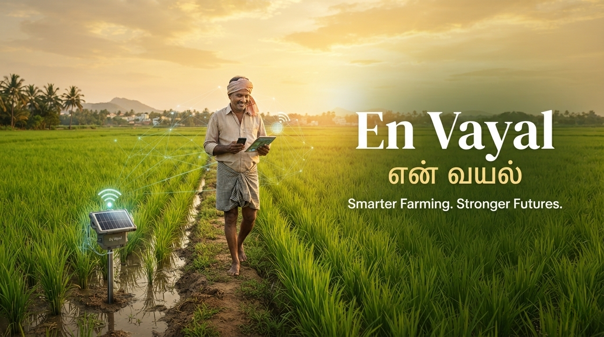

<p align="center">
  
</p>

<h1 align="center">🌾 En Vayal — என் வயல்</h1>

<p align="center">
  <em>Smarter Farming. Stronger Futures.</em>
</p>
<div align="center">

# 🌾 En Vayal | என் வயல்

### Smarter Farming. Stronger Futures. Easy to use.

**Technology with a purpose. Innovation rooted in agriculture.**

A farmer-first agri-tech initiative focused on smart field monitoring, soil testing, agricultural guidance, and accessible farming services.


*Rooted in Tamil Nadu. Growing with technology.*

</div>

---

## 🌱 About the Project

**En Vayal (என் வயல்)** means **"My Field"** — a name that reflects our vision of putting farmers and their fields first.

En Vayal is an agricultural technology initiative that aims to connect useful field information, soil-testing services, expert guidance, and agricultural resources through one accessible platform.

Our journey begins by understanding the real challenges faced by farmers, especially paddy farmers, and building practical solutions around their needs.

> Technology should make farming easier to understand, not harder to manage.

## 🎯 Our Mission

To make agricultural information and useful farming services more accessible, helping farmers make informed decisions about their fields, water, soil, and crops.

## 🌾 The Problems We Want to Solve

- 💧 Understanding soil moisture and standing-water levels.
- 🧪 Accessing soil testing and understandable results.
- 🌿 Finding reliable agricultural guidance.
- 🚚 Coordinating fertiliser availability and delivery.
- 📈 Accessing relevant market-price information.
- 📱 Making agricultural technology accessible and farmer-friendly.

## 🚀 Our Planned Solutions

These are planned capabilities, not claims that the services are already operational.

| Feature | Our vision |
| --- | --- |
| 💧 Smart Field Monitoring | Use suitable sensors to monitor soil moisture and paddy-field water depth. |
| 🧪 Soil Testing | Help farmers access soil tests and understand results. |
| 🌿 Expert Guidance | Connect farmers with qualified agricultural experts. |
| 🚚 Fertiliser Coordination | Help coordinate supplies and delivery through appropriate suppliers. |
| 📈 Market Information | Present market prices with their sources and update times. |
| 🌐 Farmer Dashboard | Build a responsive, easy-to-use web interface. |
| 🌏 Tamil Accessibility | Work towards a simple experience suited to local farmers. |

**Our approach:** Sensor readings will not replace laboratory soil testing or qualified agricultural advice. Soil and fertiliser recommendations must use appropriate testing and expert guidance.

## ✨ What Makes En Vayal Different?

- **Farmer-first thinking** — shaped by actual agricultural needs.
- **Practical technology** — focused on useful information, not unnecessary complexity.
- **Local relevance** — designed with Tamil Nadu farming in mind.
- **Connected services** — a long-term vision that brings different agricultural resources together.
- **Responsible development** — validate ideas in real conditions before making promises.

## 🏗️ Planned System Architecture

The initial product will focus on the web platform. Hardware integration can follow after suitable sensors and field conditions have been evaluated.

```text
          FARMER
             |
             v
    Responsive Web Interface
      HTML + CSS + JavaScript
             |
             v
       Python + Flask
             |
       +-----+------+
       |            |
       v            v
    Database    Service Layer
    SQLite      Soil-test records
    PostgreSQL  Market information
    (later)     Service coordination

       Future Integration
             |
      Field Sensors
             |
       Field Controller
             |
       Connectivity
             |
      Monitoring Data
             |
         Dashboard
```

The final hardware and connectivity choices will depend on field testing, network availability, cost, and sensor reliability.

## 🧰 Technology Stack

| Technology | Purpose |
| --- | --- |
| 🐍 Python | Backend logic and application services |
| ⚗️ Flask | Web framework and backend routes |
| 🌐 HTML5 | Page structure |
| 🎨 CSS3 | Responsive layouts, styling, and animations |
| ⚡ JavaScript | Interactive dashboard features |
| 🧩 Jinja2 | Dynamic HTML templates |
| 🗃️ SQLite | Initial development database |
| 🐘 PostgreSQL | Potential production database |
| 🔗 SQLAlchemy | Database models and queries |
| 🧪 pytest | Automated testing |
| 🌱 Git & GitHub | Version control and collaboration |
| 📡 ESP32 + suitable sensors | Future field-monitoring experiments |

### 🎨 Design Direction

Our planned visual identity:

- 🌲 **Emerald green** — growth and agriculture.
- 🌾 **Harvest gold** — crops and prosperity.
- 🤍 **Warm white** — simplicity and readability.
- ⚫ **Charcoal** — contrast and modern dashboards.

The interface may include subtle CSS transitions, smooth hover effects, animated loading states, and interactive charts — keeping performance and accessibility a priority.


## 🗺️ Project Roadmap

En Vayal is an early-stage initiative with a long-term vision of combining agriculture, technology, and farmer-focused services. Our roadmap focuses on understanding real agricultural needs, validating solutions, and growing sustainably.

### 🌱 Phase 1 — Research & Validation
**Status: In Progress**

- [x] Establish the En Vayal initiative and its vision.
- [x] Create a farmer survey to understand agricultural needs.
- [ ] Collect and analyse farmer responses.
- [ ] Identify the most important problems to solve.
- [ ] Research existing agricultural services and potential partners.

### 💻 Phase 2 — Digital Foundation
**Target: Months 1–3**

- [ ] Develop the initial En Vayal web application.
- [ ] Create farmer profiles and farm records.
- [ ] Implement agricultural service requests.
- [ ] Design a foundation for field-monitoring data.
- [ ] Explore partnerships with soil-testing laboratories and agricultural suppliers.

### 🚜 Phase 3 — Pilot & Field Testing
**Target: Months 3–6**

- [ ] Identify farmers willing to participate in a small pilot.
- [ ] Test an initial service based on research findings.
- [ ] Explore soil-moisture and water-level monitoring.
- [ ] Gather feedback and evaluate practical usefulness.
- [ ] Refine the service based on real-world results.

### 🌾 Phase 4 — Agricultural Services
**Target: Months 6–12**

- [ ] Explore soil-testing coordination services.
- [ ] Establish relationships with reliable agricultural suppliers.
- [ ] Explore fertiliser and agricultural input delivery.
- [ ] Introduce agricultural market-price information with reliable sources.
- [ ] Evaluate costs, pricing, and business sustainability.

### 📡 Phase 5 — Smart Farming & Expansion
**Target: Years 1–2**

- [ ] Develop and validate smart field-monitoring solutions.
- [ ] Explore sensor installation and maintenance services.
- [ ] Improve farmer access through Tamil-language support.
- [ ] Expand the service offering based on farmer demand.
- [ ] Build a reliable network of agricultural partners.

### 🏢 Phase 6 — Long-Term Vision
**Target: Years 2–5 and Beyond**

- [ ] Explore establishing a formal agricultural services company.
- [ ] Expand into additional farming communities and regions.
- [ ] Build partnerships across agricultural supply and technology.
- [ ] Create employment opportunities as the business grows.
- [ ] Reinvest in innovation, service quality, and farmer support.

> **Our vision:** To grow En Vayal into a trusted agricultural services company that combines practical farming support with technology, helping farmers access useful services while creating opportunities for sustainable growth.

**Note:** This roadmap represents planned goals, not completed or currently available services. Timelines are indicative and may change based on research, resources, partnerships, and farmer feedback.


## 📁 Planned Project Structure

```text
en-vayal/
├── app/
│   ├── __init__.py
│   ├── routes/
│   ├── models/
│   ├── services/
│   ├── templates/
│   └── static/
│       ├── css/
│       ├── js/
│       ├── images/
│       └── icons/
├── tests/
├── docs/
├── .env.example
├── .gitignore
├── config.py
├── requirements.txt
├── run.py
└── README.md
```

This is a proposed structure. We will adapt it to the actual implementation as development progresses.

## 💻 Getting Started

The application is currently in its early planning stage. Setup instructions will be finalised when the first runnable version is available.

### Prerequisites

- Python 3.11 or a compatible supported version
- Git
- A code editor such as VS Code

### Planned setup

```bash
git clone https://github.com/ChrisJeyan/en-vayal.git
cd en-vayal

python -m venv .venv

# Windows
.venv\Scripts\activate

# Install once requirements.txt is available
pip install -r requirements.txt

# Run once the application entry point is implemented
python run.py
```

Update the commands if the repository URL or project structure changes.

## 🧪 Built for Real-World Validation

Before using En Vayal for actual farming decisions, we intend to:

- Compare sensor readings with suitable reference measurements.
- Test devices under relevant field conditions.
- Record measurement units, timestamps, and limitations.
- Work with qualified experts for soil-related recommendations.
- Identify the source and update time of market information.
- Gather farmer feedback and improve usability.

## 🤝 Contributing

We welcome ideas that help make agricultural technology more useful and accessible.

Potential contribution areas include:

- Python backend development.
- Frontend design and accessibility.
- Tamil-language usability.
- Sensor research and testing.
- Documentation and automated testing.

As the project develops, contribution guidelines will be added. For now, discuss major ideas through GitHub Issues before starting substantial changes.

## 🌍 Our Vision

We envision a future where farmers can access useful field information, soil-testing support, reliable guidance, and relevant agricultural services through a simpler, connected experience.

**En Vayal starts by listening to farmers — and grows by solving the problems that matter to them.**

## 👨‍💻 Founder

Created by **Chris Jeyan**, a student developer exploring Python, web development, and practical technology for agriculture.

This initiative is in its early stages. Farmer feedback, field validation, and responsible implementation will guide its growth.

---

<div align="center">

### 🌾 En Vayal — என் வயல்

**Smarter Farming. Stronger Futures.**

*Built with curiosity. Guided by farmers. Growing one field at a time.*

</div>
